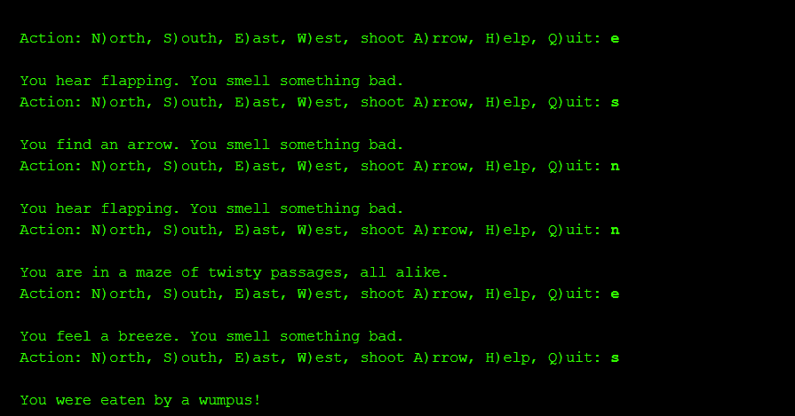

# Hunt the Xenomorph

A text-based take on the classic Hunt the Wumpus, reskinned around the Alien movies. You play Ripley, working your way through the Nostromo to escape or destroy the Xenomorph, using clues from the rooms around you and items like a flamethrower, a coolant trap, and a motion tracker, while avoiding hazards like the airlock.

This was a three-week team project for a C++ course, built with Ryan Malvey. More context is on my portfolio at [billyyork.com](https://billyyork.com).



## How to play

Each turn, the game describes what you can hear or see in the neighboring rooms and lists the actions available to you. Type the letter in parentheses to take that action:

- `N`, `S`, `E`, `W` to move
- `F` to fire the flamethrower, `C` to set a coolant trap, `T` to track the alien, `V` to use a vent, and `O` to open the airlock, when you have the item or are in the right room
- `H` for help, and `Q` to quit

Type `d` at the first prompt for debug mode, which shows a map of the ship that updates with every action.

## Building

The game builds with CMake:

```bash
cmake -S . -B build
cmake --build build
./build/hunt_the_xenomorph
```

It can also be built directly with `g++ -std=c++17 *.cpp`. The game clears the screen with the Windows `cls` command, so on macOS or Linux it prints a harmless "command not found" message when it does.

## Design

- The hazards and items are class hierarchies, so a new hazard or item type means writing one new subclass rather than touching existing code.
- Every action the player can take is its own command class, using the command pattern, and the game controller just looks up the one the player typed and runs it.
- The map is essentially a 5x5 grid with each row offset from the ones next to it, so a room's neighbors aren't the ones you'd expect from a normal grid.

I wrote the characters (Ripley and the Alien), the game controller, and the commands, and Ryan built the rooms and items.

## Known limitations

The Alien moves toward the player every turn once it wakes up, which the original rules for the game didn't allow. Both of us missed that when we read the spec.

## License

MIT
